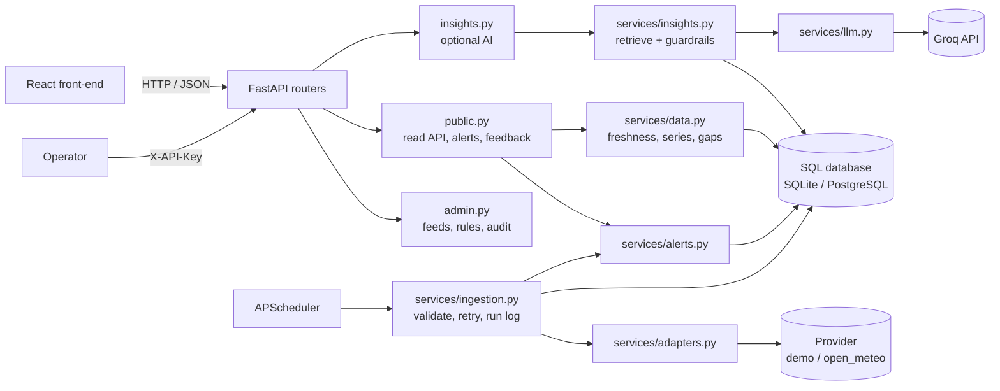

<div align="center">

# 🌊 BlueIntel Nigeria API

**Ocean and coastal data you can trust: every value comes with its source, unit, timestamp and freshness.**


[Quick start](#-quick-start) · [Endpoints](#-endpoints) · [Architecture](#-architecture) · [AI insights](#-ai-insights-groq) · [SRS coverage](#-srs-coverage)

</div>

---

FastAPI back-end for BlueIntel Nigeria, built from the *PRD & SRS v1.0*. It ingests, validates and serves ocean and coastal data, evaluates alert rules, and offers optional **Groq-powered, data-grounded AI insights**.

> [!WARNING]
> **Data status:** the default source is a synthetic **demo** generator. No real provider is approved yet (PRD §12, Appendix A). `open_meteo` is included as a *candidate* adapter and stays blocked until you set `SOURCE_LICENCE_REVIEWED=true`.

## ✨ Highlights

| | |
|---|---|
| 🏷️ **Provenance everywhere** | Every value carries unit, data type (observation / forecast / model estimate / derived), source and timestamp. |
| ⏱️ **One freshness policy** | Per-dataset limits. A stale feed is never shown as current, and old alerts are never shown as active. |
| 🕳️ **Honest gaps** | Missing values are reported as gaps. Nothing is interpolated. |
| 🚨 **Traceable alerts** | Each alert links to its rule and the exact observation that triggered it, with duplicate suppression. |
| 🤖 **Optional AI** | Source-cited answers with safety refusals. If AI is down, everything else keeps working. |
| 🔐 **Operable and auditable** | Health split between app and feeds, ingestion run log, audited admin changes. |

## 🚀 Quick start

```bash
python -m venv .venv && source .venv/bin/activate      # Windows: .venv\Scripts\activate
pip install -r requirements-dev.txt
cp .env.example .env                                   # then edit it (see below)
uvicorn app.main:app --reload                          # http://localhost:8000/docs
pytest                                                 # 50 tests, no network needed
```

Minimum `.env` edits:

| Variable | Why |
|---|---|
| `GROQ_API_KEY` | Enables `/insights/query`. Get one at [console.groq.com](https://console.groq.com). Without it only the AI endpoint returns `503 AI_NOT_CONFIGURED`; everything else works (FR-020). |
| `ADMIN_API_KEY` | Enables `/admin/*`. Generate with `python -c "import secrets; print(secrets.token_urlsafe(32))"`. Empty means admin is disabled. |
| `CORS_ORIGINS` | Your front-end origin(s). |

The first start creates the SQLite DB, seeds reference data and runs one ingestion. After that the scheduler runs it every `INGEST_INTERVAL_MINUTES`.

## 📡 Endpoints

All paths are under `/api/v1`. Interactive docs are at `/docs`.

### Public

| Method & path | Purpose | SRS |
|---|---|---|
| `GET /health` | App health **and** per-feed health, reported separately | FR-021 |
| `GET /sources` · `/locations` · `/datasets` | Metadata, licence and attribution status | 12.3 |
| `GET /locations/{id}/summary` | Latest value per indicator, freshness and warnings | FR-008 |
| `GET /locations/{id}/series?dataset=&start=&end=` | Bounded time series, each point labelled, **gaps reported** | FR-009/010 |
| `GET /locations/{id}/series.csv?dataset=&start=&end=` | CSV export with time, unit, data type, source and attribution on every row | FR-011 |
| `GET /alerts` · `GET /alert-rules` | Alerts with trigger, value, source, issue time, validity and derived status | FR-013 |
| `POST /feedback` | Optional pilot feedback (no personal data) | 12.3 |
| `POST /insights/query` | Groq-grounded Q&A with citations | FR-017–020 |

### Admin (requires `X-API-Key` or `Authorization: Bearer`)

| Method & path | Purpose | SRS |
|---|---|---|
| `GET /admin/feeds` · `/ingestion-runs` · `/audit-log` · `/feedback` | Operations views | FR-021/022 |
| `POST /admin/ingestion/run` | Run ingestion now | |
| `PATCH /admin/alert-rules/{id}` | Change thresholds. **Audited** | FR-023 |
| `PATCH /admin/sources/{id}` | Switch a faulty source on or off. **Audited** | FR-023 |
| `PATCH /admin/datasets/{key}` | Change a freshness threshold (not below the refresh interval). **Audited** | FR-024 |

Timestamps are ISO 8601 UTC. Series are limited to 14 days per request. Public data endpoints are rate-limited per IP; `/health` is not, so monitors work.

## 🏗️ Architecture



**Key decisions** (SRS §9.2):

- **Adapters are isolated.** Only `adapters.py` knows a provider's format. Swapping a source never touches the API.
- **The browser never calls providers or Groq.** Keys live only in server env vars.
- **Scheduled ingestion, not fetch-on-view.** Pages read from the database.
- **Provenance per record.** Each observation links to the ingestion run, and so the source, that produced it.
- **One freshness policy** in `services/data.py`, used by the API, alerts and AI (NFR-004).
- **Alert status is derived at read time.** A stale feed can never show an old alert as `active` (FR-015).
- **AI is optional.** If Groq is down, unconfigured or rate-limited, only `/insights/query` fails, with a clean error.

<details>
<summary><b>📁 Folder structure</b></summary>

```
blueintel-api/
├── app/
│   ├── main.py          app factory, scheduler, middleware
│   ├── config.py        settings from env
│   ├── db.py            engine/session, UTC datetime type
│   ├── models.py        tables (SRS §11 entities)
│   ├── schemas.py       request/response models
│   ├── security.py      admin auth, rate limiting, audit helper
│   ├── errors.py        consistent {"error": {code, message}}
│   ├── seed.py          sources, locations, datasets, alert rules
│   ├── routers/         public.py · insights.py · admin.py
│   └── services/        adapters.py · ingestion.py · alerts.py · data.py · insights.py · llm.py
├── tests/
└── .env.example · requirements.txt · requirements-dev.txt · Dockerfile
```

</details>

## 🤖 AI insights (Groq)

`POST /api/v1/insights/query` with `{"question": "...", "location_id": "lekki"}` (location optional).

1. **Safety gate first.** Questions about whether it is safe, navigation, emergencies or guarantees get a fixed refusal pointing to official sources, with no LLM call. Fish-location prediction is declined as unsupported (FR-019).
2. **Retrieve before answering.** Latest values, 24 h range, 6 h change, forecast max and alerts are pulled from the database as numbered evidence (`[E1]`, `[E2]`, …). No evidence means "cannot answer reliably", with no LLM call (FR-017).
3. **Constrained prompt.** Use only the evidence, cite every fact, state data type and time, disclose stale or missing data, and treat question and evidence as *untrusted* (prompt-injection defence).
4. **Output checks.** An answer with no citation, an unknown citation id, or "it is safe to…" wording is blocked (`ungrounded_blocked`).
5. **Privacy.** The log stores model, evidence count, latency and a hash of the question, never the question text.

The model is set by `GROQ_MODEL`; check Groq's current model list, as models are retired over time. Requests are rate-limited per IP (`INSIGHTS_RATE_LIMIT_PER_MINUTE`).

> [!NOTE]
> The PRD treats AI insights (§5.4) as post-MVP unless validated. The endpoint is built and isolated (FR-020), and can be switched off with `AI_ENABLED=false`, so you can pilot without it.

## 🔌 Adding a real data source

1. Review the provider's licence, attribution, coverage, limits and commercial-use terms, and record them in `seed.py`.
2. Write an adapter class in `adapters.py` returning `RawRecord`s with the correct kind (`observation` only for real measurements; model output is `model_estimate`).
3. Set `ACTIVE_SOURCE=<id>` and `SOURCE_LICENCE_REVIEWED=true`.
4. Have the thresholds in `seed.py` reviewed by a marine or meteorological specialist before any pilot.

## ✅ SRS coverage

| Status | Items |
|---|---|
| ✅ Implemented | FR-006–015 · FR-011 (server-side CSV) · FR-017–024 · NFR-002/004/005/006/008/011 · NFR-007 (HSTS in production; TLS terminates at the proxy) · security controls in §14.1 |
| ⏭️ Not implemented | FR-016 (email/SMS/push, optional in the MVP) · user accounts (PRD 14.2: not needed for MVP) |

Notes: FR-024 freshness thresholds are admin-configurable, but the coverage area is set in `seed.py`. Security controls include secrets in env, validated input, parameterised queries, rate limits, admin auth and no secrets in logs.

## ⚠️ Known limits and next steps

- **Verified:** all 50 tests pass and the server was smoke-tested locally. The Groq client is tested against a mocked HTTP transport, and the Open-Meteo adapter is *not* exercised because tests must not call external services. **Test both with your real key and the live API before relying on them.**
- **Migrations:** tables are created with `create_all`. Add Alembic before changing the schema in production.
- **Scaling:** the scheduler and rate limiter run in-process (use one worker). For several instances, run ingestion as a separate job and move the limiter to Redis.
- **Reverse proxy:** configure forwarded headers so the rate limiter sees real client IPs, and terminate TLS at the proxy (NFR-007).
- **Backups and monitoring:** use your database host's backups and test a restore before launch (NFR-008). Alert on `/api/v1/health` → `feeds.status != healthy`.
- **Admin auth** is a single shared key. Replace it with real users and roles if several operators are needed.
- **Placeholders:** alert thresholds are illustrative, and the Lagos coast and three indicators are assumptions pending the PRD §18 decisions.
