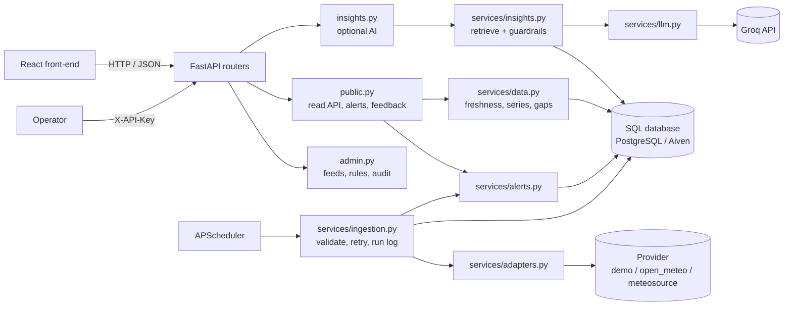

<div align="center">

# 🌊 Orizon Nimasa API

**Ocean and coastal data you can trust: every value comes with its source, unit, timestamp and freshness.**


[Quick start](#-quick-start) · [Endpoints](#-endpoints) · [Architecture](#-architecture) · [AI insights](#-ai-insights-groq) · [SRS coverage](#-srs-coverage)

</div>

---

FastAPI back-end for Orizon Nimasa, built from the *PRD & SRS v1.0*. It ingests, validates and serves ocean and coastal data, evaluates alert rules, and offers optional **Groq-powered, data-grounded AI insights**.

> [!WARNING]
> **Data status:** the default source is a synthetic **demo** generator. No real provider is approved yet (PRD §12, Appendix A). `open_meteo` and `meteosource` are included as *candidate* adapters and stay blocked until you set `SOURCE_LICENCE_REVIEWED=true`.

## ✨ Highlights

| | |
|---|---|
| 🏷️ **Provenance everywhere** | Every value carries unit, data type (observation / forecast / model estimate / derived), source and timestamp. |
| ⏱️ **One freshness policy** | Per-dataset limits. A stale feed is never shown as current, and old alerts are never shown as active. |
| 🕳️ **Honest gaps** | Missing values are reported as gaps. Nothing is interpolated. |
| 🚨 **Traceable alerts** | Each alert links to its rule and the exact observation that triggered it, with duplicate suppression. |
| 🤖 **Optional AI** | Source-cited answers with safety refusals. If AI is down, everything else keeps working. |
| 🔐 **Operable and auditable** | Health split between app and feeds, ingestion run log, audited admin changes. |

## 🚀 Quick start

```bash
python -m venv .venv && source .venv/bin/activate      # Windows: .venv\Scripts\activate
pip install -r requirements-dev.txt
cp .env.example .env                                   # then edit it (see below)
uvicorn app.main:app --reload --port 8015                          # http://localhost:8015/docs
pytest                                                 # 62 tests, no network needed
```

Minimum `.env` edits:

| Variable | Why |
|---|---|
| `GROQ_API_KEY` | Enables `/insights/query`. Get one at [console.groq.com](https://console.groq.com). Without it only the AI endpoint returns `503 AI_NOT_CONFIGURED`; everything else works (FR-020). |
| `ADMIN_BOOTSTRAP_EMAIL` / `ADMIN_BOOTSTRAP_PASSWORD` | Creates the **first administrator** on startup when none exist (password at least 12 characters). Remove both afterwards and add staff through the API. |
| `CORS_ORIGINS` | Your front-end origin(s). |

`ADMIN_API_KEY` is optional: a service key for scripts and automation. It cannot manage staff. Leave it empty to disable it.

## 🗄️ Database (Aiven PostgreSQL)

The same managed Aiven PostgreSQL service is used for local development and production. Nothing else needs installing locally.

1. In the Aiven console, open your PostgreSQL service and copy the **Service URI** from *Overview*.
2. **Use a separate database for each environment** so local testing never touches production data. In the service's *Databases* tab create `blueintel_dev` and `blueintel_prod`, then replace `defaultdb` in the URI:
   ```
   # local .env
   DATABASE_URL=postgres://avnadmin:<password>@<host>.aivencloud.com:<port>/blueintel_dev?sslmode=require
   # production environment variable
   DATABASE_URL=postgres://avnadmin:<password>@<host>.aivencloud.com:<port>/blueintel_prod?sslmode=require
   ```
   The `postgres://` prefix is converted automatically. Keep `?sslmode=require`.
3. If your Aiven service restricts IP addresses, add your local machine's and your host's addresses under *Allowed IP addresses*.
4. Check the connection (the password is never printed):
   ```bash
   python -m app.dbcheck
   # OK  PostgreSQL 16.x, database 'blueintel_dev', TLS: yes
   ```
5. Start the API. Tables are created and seeded on first start.

PostgreSQL is the only supported database; there is no local fallback. Keep real credentials in `.env` (git-ignored) or your host's secret store, never in the repo.

### Running the tests

Tests run against PostgreSQL too, in their own database, because **every test starts by dropping all tables**. In the Aiven console create a database named `blueintel_test`, then add its URI to `.env`:

```
TEST_DATABASE_URL=postgres://avnadmin:<password>@<host>.aivencloud.com:<port>/blueintel_test?sslmode=require
```

`pytest` refuses to run unless the database name ends in `_test` and differs from `DATABASE_URL`, so it can never wipe your dev or prod data. Because each test resets the database over the network, the suite takes a few minutes.

## 🔑 Who can do what

| Role | Can | Login |
|---|---|---|
| **Public visitor** | View published maps, charts and public alerts. Nothing to register, no password. | **No** |
| **Administrator** | Manage data sources, alert rules and freshness settings, inspect ingestion failures and **manage staff access** | **Yes** |

```bash
# Sign in (returns a bearer token valid for ADMIN_SESSION_HOURS, default 8)
curl -X POST localhost:8015/api/v1/admin/auth/login -H "Content-Type: application/json" \
     -d '{"email": "you@example.com", "password": "your-password"}'

# Use it
curl localhost:8015/api/v1/admin/feeds -H "Authorization: Bearer <access_token>"
```

Passwords are hashed with scrypt, and only a digest of each session token is stored. After `ADMIN_MAX_FAILED_LOGINS` (5) wrong passwords an account locks for `ADMIN_LOCKOUT_MINUTES` (15); login is also rate-limited per IP. Failed logins never reveal whether an email is registered. Deactivating a person or resetting their password signs them out everywhere at once.

The first start creates the tables in your PostgreSQL database, seeds reference data and runs one ingestion. After that the scheduler runs it every `INGEST_INTERVAL_MINUTES`.

## 📡 Endpoints

All paths are under `/api/v1`. Interactive docs are at `/docs`.

### Public

| Method & path | Purpose | SRS |
|---|---|---|
| `GET /health` | App health **and** per-feed health, reported separately | FR-021 |
| `GET /sources` · `/locations` · `/datasets` | Metadata, licence and attribution status | 12.3 |
| `GET /locations/{id}/summary` | Latest value per indicator, freshness and warnings | FR-008 |
| `GET /locations/{id}/series?dataset=&start=&end=` | Bounded time series, each point labelled, **gaps reported** | FR-009/010 |
| `GET /locations/{id}/series.csv?dataset=&start=&end=` | CSV export with time, unit, data type, source and attribution on every row | FR-011 |
| `GET /locations/{id}/series.png` · `.jpg` · `.pdf` (same query) | Chart export as an image or PDF, with source, data type and generation time on the page | FR-011 |
| `GET /alerts?category=` · `GET /alert-rules` | Alerts with trigger, value, source, issue time, validity and derived status. `category` is `coastal`, `ocean_navigation` or `waterway_navigation` | FR-013 |
| `POST /feedback` | Optional pilot feedback (no personal data) | 12.3 |
| `POST /insights/query` | Groq-grounded Q&A with citations | FR-017–020 |

Navigation alerts cover **ocean navigation** (offshore and coastal areas) and **waterway navigation** (lagoons and creeks) using wave height, wind, visibility and current speed. Each location has a `zone` (`coastal`, `waterway`, `offshore`; defined in `app/zones.py`) and each rule applies only to the zones it is meant for. The thresholds are illustrative and need review by a qualified marine specialist before pilot use.

### Admin (requires `Authorization: Bearer <session token>`)

| Method & path | Purpose | SRS |
|---|---|---|
| `POST /admin/auth/login` · `/logout` · `/change-password` · `GET /admin/auth/me` | Staff sign-in and session management (login is the only unauthenticated admin path) | NFR-006 |
| `GET /admin/staff` · `POST /admin/staff` · `PATCH /admin/staff/{id}` | List, add, deactivate staff or reset a password. **Audited**; needs a staff login, not the service key | NFR-006 |
| `GET /admin/feeds` · `/ingestion-runs` · `/audit-log` · `/feedback` | Operations views | FR-021/022 |
| `POST /admin/ingestion/run` | Run ingestion now | |
| `PATCH /admin/alert-rules/{id}` | Change thresholds. **Audited** | FR-023 |
| `PATCH /admin/sources/{id}` | Switch a faulty source on or off. **Audited** | FR-023 |
| `PATCH /admin/datasets/{key}` | Change a freshness threshold (not below the refresh interval). **Audited** | FR-024 |

Timestamps are ISO 8601 UTC. Series are limited to 14 days per request. Public data endpoints are rate-limited per IP; `/health` is not, so monitors work.

## 🏗️ Architecture



**Key decisions** (SRS §9.2):

- **Adapters are isolated.** Only `adapters.py` knows a provider's format. Swapping a source never touches the API.
- **The browser never calls providers or Groq.** Keys live only in server env vars.
- **Scheduled ingestion, not fetch-on-view.** Pages read from the database.
- **Provenance per record.** Each observation links to the ingestion run, and so the source, that produced it.
- **One freshness policy** in `services/data.py`, used by the API, alerts and AI (NFR-004).
- **Alert status is derived at read time.** A stale feed can never show an old alert as `active` (FR-015).
- **AI is optional.** If Groq is down, unconfigured or rate-limited, only `/insights/query` fails, with a clean error.

<details>
<summary><b>📁 Folder structure</b></summary>

```
blueintel-api/
├── app/
│   ├── main.py          app factory, scheduler, middleware
│   ├── config.py        settings from env
│   ├── db.py            engine/session, UTC datetime type
│   ├── models.py        tables (SRS §11 entities)
│   ├── schemas.py       request/response models
│   ├── security.py      admin auth, rate limiting, audit helper
│   ├── errors.py        consistent {"error": {code, message}}
│   ├── seed.py          sources, locations, datasets, alert rules
│   ├── routers/         public.py · insights.py · admin.py
│   └── services/        adapters.py · ingestion.py · alerts.py · data.py · insights.py · llm.py
├── tests/
└── .env.example · requirements.txt · requirements-dev.txt · Dockerfile
```

</details>

## 🤖 AI insights (Groq)

`POST /api/v1/insights/query` with `{"question": "...", "location_id": "lekki"}` (location optional).

1. **Safety gate first.** Questions about whether it is safe, navigation, emergencies or guarantees get a fixed refusal pointing to official sources, with no LLM call. Fish-location prediction is declined as unsupported (FR-019).
2. **Retrieve before answering.** Latest values, 24 h range, 6 h change, forecast max and alerts are pulled from the database as numbered evidence (`[E1]`, `[E2]`, …). No evidence means "cannot answer reliably", with no LLM call (FR-017).
3. **Constrained prompt.** Use only the evidence, cite every fact, state data type and time, disclose stale or missing data, and treat question and evidence as *untrusted* (prompt-injection defence).
4. **Output checks.** An answer with no citation, an unknown citation id, or "it is safe to…" wording is blocked (`ungrounded_blocked`).
5. **Privacy.** The log stores model, evidence count, latency and a hash of the question, never the question text.

The model is set by `GROQ_MODEL`; check Groq's current model list, as models are retired over time. Requests are rate-limited per IP (`INSIGHTS_RATE_LIMIT_PER_MINUTE`).

> [!NOTE]
> The PRD treats AI insights (§5.4) as post-MVP unless validated. The endpoint is built and isolated (FR-020), and can be switched off with `AI_ENABLED=false`, so you can pilot without it.

## 🔌 Adding a real data source

1. Review the provider's licence, attribution, coverage, limits and commercial-use terms, and record them in `seed.py`.
2. Write an adapter class in `adapters.py` returning `RawRecord`s with the correct kind (`observation` only for real measurements; model output is `model_estimate`).
3. Set `ACTIVE_SOURCE=<id>` and `SOURCE_LICENCE_REVIEWED=true`.
4. Have the thresholds in `seed.py` reviewed by a marine or meteorological specialist before any pilot.

## ✅ SRS coverage

| Status | Items |
|---|---|
| ✅ Implemented | FR-006–015 · FR-011 (server-side CSV) · FR-017–024 · NFR-002/004/005/006/008/011 · NFR-007 (HSTS in production; TLS terminates at the proxy) · security controls in §14.1 |
| ⏭️ Not implemented | FR-016 (email/SMS/push, optional in the MVP) · public user accounts (PRD 14.2: the public needs no login) |

Notes: FR-024 freshness thresholds are admin-configurable, but the coverage area is set in `seed.py`. Security controls include secrets in env, validated input, parameterised queries, rate limits, admin auth and no secrets in logs.

## ⚠️ Known limits and next steps

- **Verified:** all 62 tests pass and the server was smoke-tested locally. The Groq client is tested against a mocked HTTP transport, and the Open-Meteo adapter is *not* exercised because tests must not call external services. **Test both with your real key and the live API before relying on them.**
- **Migrations:** tables are created with `create_all`, which only creates missing tables and never alters existing ones. Add Alembic before changing the schema on a database that already holds data (such as your Aiven production database).
- **Aiven backups:** Aiven takes automatic backups; test a restore before launch (NFR-008).
- **Scaling:** the scheduler and rate limiter run in-process (use one worker). For several instances, run ingestion as a separate job and move the limiter to Redis.
- **Reverse proxy:** configure forwarded headers so the rate limiter sees real client IPs, and terminate TLS at the proxy (NFR-007).
- **Backups and monitoring:** use your database host's backups and test a restore before launch (NFR-008). Alert on `/api/v1/health` → `feeds.status != healthy`.
- **Admin auth:** there is one role (administrator) and no self-service password reset or MFA yet. Reset passwords through `PATCH /admin/staff/{id}`. Sessions are stored in the database, so they survive restarts and work across instances.
- **Placeholders:** alert thresholds are illustrative, and the Lagos coast and three indicators are assumptions pending the PRD §18 decisions.
