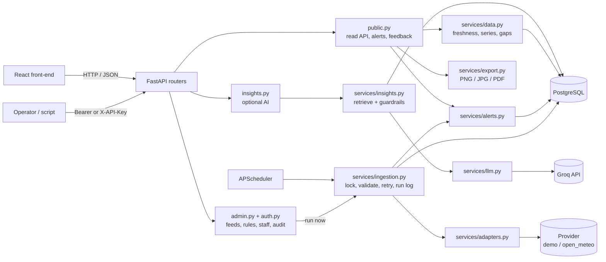

# Orizon Nimasa API

**The FastAPI back-end for Orizon Nimasa: ocean and coastal data where every value carries its source, unit, data type, timestamp and freshness.**

This service does five things:

1. **Ingests** marine and weather readings from a data source on a schedule.
2. **Validates and stores** them in PostgreSQL, with every record traceable to the ingestion run that produced it.
3. **Evaluates alert rules** against the stored data and derives each alert's status (active / expired / not current) at read time.
4. **Serves** maps, charts, summaries, alerts and CSV/PNG/JPG/PDF exports through a public JSON API, plus a protected operations API for staff.
5. **Optionally answers questions** about the data with a Groq-hosted LLM, grounded in numbered evidence and wrapped in safety guardrails.

It is the server half of the Orizon Nimasa web app. The React front-end calls it at `/api/v1` and never talks to data providers or to Groq itself.

> **Data status:** the default source is a synthetic **demo** generator, so every value is fictional. No real provider is approved yet. `open_meteo` is included as a *candidate* adapter and stays blocked until you set `SOURCE_LICENCE_REVIEWED=true`. Alert thresholds are illustrative placeholders that need review by a marine or meteorological specialist.

Built with Python 3.11+ (the Docker image uses 3.12), FastAPI, SQLAlchemy 2, PostgreSQL (psycopg 3), APScheduler, httpx and matplotlib.

---

## Platform features

Beyond the original map/chart API, this build adds:

- **Role-based staff access** (`admin`, `operator`, `viewer`), TOTP MFA, single-use password-reset tokens and session revocation.
- **Full admin CRUD** for sources, datasets, alert rules, locations, API keys, notification targets, staff and durable jobs. Every change is audited.
- **Developer sandbox** at `/api/v1/developer/*`: self-service keys (one shown once, SHA-256 at rest), per-key daily quota metering and rate limits, plus copy-ready cURL/JavaScript recipes.
- **Notification outbox** with email (SMTP), webhook and SMS-ready targets, retries, delivery status and an admin test button.
- **Durable job queue** using PostgreSQL `FOR UPDATE SKIP LOCKED` for ingestion, notification dispatch, retention and quality scans.
- **Marine endpoints** at `/api/v1/vessels`, `/vessels/{mmsi}/track`, `/bathymetry`, `/tides` and `/data-quality`. Demo AIS, bathymetry and harmonic tides are synthetic and labelled as such; no real provider credentials are bundled.
- **Data-quality scoring** based on freshness, observations, rejected runs, active alerts, gaps and completeness.

## What it serves

### Coverage

**Eight locations** on the Lagos coast, in three zones. Zones are defined in `app/zones.py` and decide which alert rules apply where.

| Zone | Locations |
|---|---|
| `coastal` | Badagry, Lagos Harbour (Apapa), Bar Beach (Victoria Island), Lekki, Eleko |
| `waterway` | Lagos Lagoon, Badagry Creek |
| `offshore` | Lagos Offshore Approach |

The coastal area is a placeholder until the pilot area is confirmed.

**Five datasets (indicators).** Each has its own refresh interval, stale-after limit (admin-editable) and plausible range used to reject bad values.

| Key | Indicator | Unit | Refresh | Stale after | Forecast | Plausible range |
|---|---|---|---|---|---|---|
| `wave_height` | Wave height | m | 60 min | 180 min | yes | 0 to 30 |
| `wind_speed` | Wind speed | km/h | 60 min | 120 min | yes | 0 to 300 |
| `sst` | Sea surface temperature | °C | 360 min | 720 min | no | 0 to 40 |
| `visibility` | Visibility | km | 60 min | 180 min | yes | 0 to 100 |
| `current_speed` | Current speed | km/h | 60 min | 180 min | yes | 0 to 30 |

**Four data types**, attached to every point: `observation`, `forecast`, `model_estimate`, `derived`. The demo source labels wind as `observation` and everything else as `model_estimate`. The Open-Meteo adapter labels all non-forecast values `model_estimate`, because they come from a model.

### The rules every response follows

- **Provenance everywhere.** Each value carries unit, data type, source and timestamp. The source comes from the ingestion run that produced the record, not from current configuration.
- **One freshness policy.** `fresh`, `stale` or `empty`, computed from the dataset's stale-after limit. Exactly at the limit is still fresh. The same function serves the API, alerts and AI. A stale feed is never shown as current.
- **Honest gaps.** A gap is a hole larger than 1.5 times the expected interval. Gaps are reported in a separate `gaps` list. Nothing is interpolated.
- **Traceable alerts.** Each alert links to its rule and to the exact observation that triggered it.
- **UTC on the wire.** Every timestamp is ISO 8601 UTC. The UI converts to WAT (UTC+1).

### Alert rules

Nine rules are seeded. The comparison is inclusive, and a repeat trigger inside the suppression window does not create a new alert.

| Rule id | Category | Condition | Applies to | Suppress / valid |
|---|---|---|---|---|
| `wave-high` | `coastal` | wave height ≥ 2.0 m | coastal, offshore | 6 h / 6 h |
| `wind-strong` | `coastal` | wind ≥ 28 km/h | all zones | 3 h / 3 h |
| `nav-ocean-waves` | `ocean_navigation` | wave height ≥ 2.5 m | coastal, offshore | 6 h / 6 h |
| `nav-ocean-wind` | `ocean_navigation` | wind ≥ 40 km/h | coastal, offshore | 3 h / 3 h |
| `nav-ocean-visibility` | `ocean_navigation` | visibility ≤ 2 km | coastal, offshore | 3 h / 3 h |
| `nav-ocean-current` | `ocean_navigation` | current ≥ 5.5 km/h | coastal, offshore | 6 h / 6 h |
| `nav-waterway-wind` | `waterway_navigation` | wind ≥ 22 km/h | waterway | 3 h / 3 h |
| `nav-waterway-visibility` | `waterway_navigation` | visibility ≤ 1 km | waterway | 3 h / 3 h |
| `nav-waterway-current` | `waterway_navigation` | current ≥ 4 km/h | waterway | 6 h / 6 h |

Rules ignore forecast, missing and non-finite values. Events are created during ingestion by looking back 72 hours (`ALERT_LOOKBACK_HOURS`). **Status is derived on every read**, never stored:

| Status | Meaning |
|---|---|
| `active` | Within its validity window and the underlying feed is fresh. |
| `suppressed_stale` | Within its validity window but the feed is stale, so it must be shown as "not current". |
| `expired` | Past `valid_until`. |

Thresholds, enabled flags, suppression and validity windows can be changed at runtime through `PATCH /admin/alert-rules/{id}` (audited).

---

## Quick start

Requires Python 3.11+ and a PostgreSQL database. PostgreSQL is the only supported database and there is no local fallback. The project is set up for Aiven PostgreSQL, but any PostgreSQL URL works (the suite was run against PostgreSQL 16).

```bash
python -m venv .venv && source .venv/bin/activate      # Windows: .venv\Scripts\activate
pip install -r requirements-dev.txt
cp .env.example .env                                   # then edit it (see below)
python -m app.dbcheck                                  # optional: verify the database connection
uvicorn app.main:app --reload --port 8015              # http://localhost:8015/docs
```

Minimum `.env` edits:

| Variable | Why |
|---|---|
| `DATABASE_URL` | **Required.** The server will not start without it. |
| `ADMIN_BOOTSTRAP_EMAIL` / `ADMIN_BOOTSTRAP_PASSWORD` | Creates the **first administrator** on startup when none exist (password at least 12 characters, otherwise startup fails). Remove both afterwards and add staff through the API. |
| `CORS_ORIGINS` | Your front-end origin(s), comma-separated. Default `http://localhost:5173`. |
| `GROQ_API_KEY` | Optional. Enables `/insights/query`. Without it only that endpoint returns `503 AI_NOT_CONFIGURED`. |

**What the first start does:** creates all tables, seeds the sources, locations, datasets and alert rules, creates the bootstrap administrator, and runs one ingestion immediately. With the demo source that stores about 8,900 records. After that the scheduler repeats ingestion every `INGEST_INTERVAL_MINUTES`.

Check it is alive:

```bash
curl localhost:8015/api/v1/health
curl "localhost:8015/api/v1/summaries?locations=lekki"
```

### Using Aiven PostgreSQL

1. In the Aiven console open your PostgreSQL service and copy the **Service URI** from *Overview*.
2. **Use a separate database per environment** (for example `blueintel_dev`, `blueintel_prod`, `blueintel_test`) so local work never touches production data. Replace `defaultdb` in the URI:
   ```
   DATABASE_URL=postgres://avnadmin:<password>@<host>.aivencloud.com:<port>/blueintel_dev?sslmode=require
   ```
   The `postgres://` prefix is converted automatically. Keep `?sslmode=require`.
3. If the service restricts IP addresses, allow your machine and your host under *Allowed IP addresses*.
4. Run `python -m app.dbcheck`. It prints the server version, database name and whether TLS is in use, and never prints the password.

### Running the tests

```bash
# .env or environment: BOTH must be set, and they must be different databases
DATABASE_URL=postgres://.../blueintel_dev?sslmode=require
TEST_DATABASE_URL=postgres://.../blueintel_test?sslmode=require

pytest        # 96 tests, no external network calls
```

- **Both URLs are required.** The app is created when `app.main` is imported, so `pytest` fails at start-up if `DATABASE_URL` is missing, even though the tests themselves use `TEST_DATABASE_URL`.
- **Every test starts by dropping all tables.** `pytest` therefore refuses to run unless the test database name ends in `_test` and differs from `DATABASE_URL`.
- Groq is replaced by a fake client and the Open-Meteo adapter is not exercised, so no test touches an external service.
- On a local PostgreSQL the suite takes a few minutes. Against a remote host expect longer, because each test resets the database over the network.

---

## Configuration

All settings come from environment variables or `.env` (see `.env.example`). Inline `# comments` in `.env` are handled correctly.

| Variable | Default | Purpose |
|---|---|---|
| `APP_ENV` | `development` | Set to `production` to enable HSTS and the strict service-key length check. |
| `LOG_LEVEL` | `INFO` | Logs are JSON, one object per line, on stdout. |
| `CORS_ORIGINS` | `http://localhost:5173` | Allowed front-end origins. Methods allowed: GET, POST, PATCH, DELETE. |
| `DATABASE_URL` | none, **required** | PostgreSQL URL. Non-PostgreSQL URLs are rejected at start-up. |
| `TEST_DATABASE_URL` | none | Used only by `pytest`. Must end in `_test`. |
| `ADMIN_BOOTSTRAP_EMAIL`, `ADMIN_BOOTSTRAP_PASSWORD` | empty | First administrator, created only if no administrators exist. |
| `ADMIN_SESSION_HOURS` | `8` | Lifetime of a login token. |
| `ADMIN_MAX_FAILED_LOGINS` / `ADMIN_LOCKOUT_MINUTES` | `5` / `15` | Account lockout. |
| `LOGIN_RATE_LIMIT_PER_MINUTE` | `10` | Per IP. |
| `ADMIN_API_KEY` | empty (disabled) | Optional service key for scripts. At least 24 characters when `APP_ENV=production`. |
| `ACTIVE_SOURCE` | `demo` | `demo` or `open_meteo`. See [Adding a real data source](#adding-a-real-data-source) for how it really behaves. |
| `SOURCE_LICENCE_REVIEWED` | `false` | Must be `true` before any non-demo source will ingest. |
| `SCHEDULER_ENABLED` | `true` | Runs ingestion inside the web process. |
| `INGEST_INTERVAL_MINUTES` | `60` | Scheduler period. |
| `INGEST_MAX_RETRIES` / `INGEST_BACKOFF_SECONDS` | `3` / `2` | Retries for provider errors, with exponential backoff. |
| `INGEST_TIMEOUT_SECONDS` | `20` | Provider request timeout. |
| `RETENTION_DAYS` | `90` | Observations older than this are deleted after each run. |
| `DEMO_LAG_HOURS` | `0` | Makes the demo feed N hours old, to test stale-data behaviour. |
| `AI_ENABLED` | `true` | Set `false` to switch the AI endpoint off. |
| `GROQ_API_KEY`, `GROQ_MODEL`, `GROQ_BASE_URL`, `GROQ_TIMEOUT_SECONDS` | empty, `llama-3.3-70b-versatile`, Groq URL, `20` | Check Groq's current model list, as models are retired over time. |
| `RATE_LIMIT_PER_MINUTE` | `30` | Per IP, for public data endpoints and feedback. |
| `INSIGHTS_RATE_LIMIT_PER_MINUTE` | `6` | Per IP, for the AI endpoint. |
| `MAX_SERIES_DAYS` | `14` | Longest time range per series request. |
| `ALERT_LOOKBACK_HOURS` | `72` | How far back alert evaluation looks. |
| `ADMIN_BOOTSTRAP_ROLE` | `admin` | Role of the first account: admin, operator or viewer. |
| `PUBLIC_BASE_URL` / `PASSWORD_RESET_HOURS` | `http://localhost:5173` / `1` | Password-reset link origin and token lifetime. |
| `DEVELOPER_KEY_*` | `1000`/`60`/`5` | Sandbox key daily quota, per-minute limit and per-IP hourly creation limit. |
| `JOBS_ENABLED` / `JOB_POLL_SECONDS` | `true` / `30` | Durable job worker schedule. |
| `NOTIFICATIONS_ENABLED` / `SMTP_*` / `WEBHOOK_TIMEOUT_SECONDS` | enabled / empty / `10` | Notification outbox delivery. Real SMS/webhook credentials are not bundled. |
| `AIS_PROVIDER` / `BATHYMETRY_PROVIDER` / `TIDE_PROVIDER` | `demo` / `demo` / `harmonic-demo` | Provider-ready marine adapters. Demo data is synthetic and not for navigation. |

---

## Using it with the front-end

The Orizon Nimasa React app switches from its built-in synthetic data to this API when `VITE_API_BASE_URL` is set.

1. Run this API on port **8015** (the port the front-end's `.env.example` and Dockerfile use).
2. Add the front-end's origin to `CORS_ORIGINS` (for example `http://localhost:5173`) and restart the API. Alternatively, set the front-end's `VITE_API_BASE_URL` to `/api/v1` and let its Vite dev server proxy `/api` to this service, which needs no CORS.
3. The front-end loads all data with `GET /series` (one call per indicator, all locations) and `GET /alerts`, polls every 5 minutes, and keeps the admin bearer token in `sessionStorage`.

`docs/FRONTEND_API.md` is the detailed contract for front-end developers.

---

## Who can do what

| Role | Can | Login |
|---|---|---|
| **Public visitor** | View maps, charts, summaries and alerts, export data, send feedback, use the AI endpoint. | No |
| **Administrator** | Everything above, plus run ingestion, change alert thresholds, freshness limits and source switches, read feedback and the audit log, and **manage staff**. | Yes |

There is a single administrator role, and the public never has accounts.

```bash
# Sign in. "email" accepts an email address OR a staff ID such as STF001.
# The response contains a bearer token valid for ADMIN_SESSION_HOURS (default 8).
curl -X POST localhost:8015/api/v1/admin/auth/login -H "Content-Type: application/json" \
     -d '{"email": "you@example.com", "password": "your-password"}'

# Use it
curl localhost:8015/api/v1/admin/feeds -H "Authorization: Bearer <access_token>"
```

**Credentials and sessions**
- Passwords are hashed with scrypt (minimum 12 characters). Only a SHA-256 digest of each session token is stored.
- After `ADMIN_MAX_FAILED_LOGINS` wrong passwords an account locks for `ADMIN_LOCKOUT_MINUTES`. Login is also rate-limited per IP. Every login failure returns the same `401 INVALID_CREDENTIALS`, so it never reveals whether an account exists.
- Deactivating someone or resetting their password signs them out everywhere. Changing your own password signs out your other sessions.
- If there are no administrator accounts and no service key, admin routes return `503 ADMIN_DISABLED`.

**The optional service key** (`ADMIN_API_KEY`, sent as `X-API-Key` or as a bearer token) is for scripts. It can call the operations endpoints but **cannot** manage staff or use `/admin/auth/*`: those return `403 STAFF_LOGIN_REQUIRED`.

---

## API reference

All paths are under `/api/v1`. Interactive docs are at `/docs` (Swagger) and `/redoc`, and the schema is at `/openapi.json`.

**Conventions**
- **Errors** always look like `{"error": {"code": "...", "message": "..."}}`. Validation errors (422) add `error.details`.
- **Times** are ISO 8601 UTC. Query parameters that take a time **must include a timezone**.
- **Series range** is at most 14 days (`422 RANGE_TOO_LARGE`). The default window is 48 h back to 48 h ahead, so forecasts are included.
- **Rate limits** are per IP and per process: 30 requests/min on the data, alert, export and feedback endpoints, 10/min on login, 6/min on AI. Over the limit returns `429 RATE_LIMITED`. `/health`, `/sources`, `/locations`, `/datasets` and `/alert-rules` are not limited, so monitors work.
- **Caching:** responses outside `/admin` carry `Cache-Control: public, max-age=30`. Admin responses are `no-store`. Every response has an `X-Request-ID`.

### Public

| Method & path | Purpose |
|---|---|
| `GET /health` | App health and per-feed health, reported **separately**. `feeds.status` is `healthy`, `degraded` or `unknown` (no enabled source). |
| `GET /sources` · `/locations` · `/datasets` | Metadata: licence and attribution status, location zones, freshness limits. |
| `GET /summaries?locations=a,b` | Latest value, data type, age and freshness for every indicator, for several locations in one request (default: all, max 20). Includes active alert counts and warnings. |
| `GET /locations/{id}/summary` | The same for one location. |
| `GET /locations/{id}/series?dataset=&start=&end=` | Time series with every point labelled and **gaps reported**. |
| `GET /series?locations=a,b&dataset=&start=&end=` | The same for several locations in one request (max 20), in the order requested. |
| `GET /locations/{id}/series.csv?dataset=&start=&end=` | CSV with time, unit, data type, source and attribution on every row. |
| `GET /locations/{id}/series.png` · `.jpg` · `.pdf` | Chart export (observed solid, forecast dashed, gaps left open, source and generation time in the footer). Same query and limits. |
| `GET /alerts?location_id=&category=&status=&include_expired=` | Alerts with trigger, value, source, issue time, validity and derived status. `category` is `coastal`, `ocean_navigation` or `waterway_navigation`. |
| `GET /alert-rules` | The rules and their review status. |
| `POST /feedback` | Optional pilot feedback (`found_information`, `source_clarity`, `comments`). At least one answer is required, and no personal data is collected. |
| `POST /insights/query` | Data-grounded Q&A with citations. See [AI insights](#ai-insights-groq). |

### Admin (`Authorization: Bearer <session token>`)

Every change below is written to the audit log.

| Method & path | Purpose |
|---|---|
| `POST /admin/auth/login` | Sign in (the only unauthenticated admin route). |
| `POST /admin/auth/logout` · `/change-password` · `GET /admin/auth/me` | Session management. Staff login required. |
| `GET /admin/staff` · `POST /admin/staff` · `PATCH /admin/staff/{id}` | List, add, deactivate/reactivate staff or reset a password. You cannot deactivate yourself. Staff login required. |
| `GET /admin/feeds` | Freshness of every dataset at every location, plus the 20 most recent ingestion runs. |
| `GET /admin/ingestion-runs?limit=` | Run history (run id, source, outcome, records, rejected, error category). |
| `POST /admin/ingestion/run?source=` | Run ingestion now. `409 INGESTION_IN_PROGRESS` if one is already running. |
| `GET /admin/alert-rules` · `PATCH /admin/alert-rules/{id}` | List rules; change `threshold`, `enabled`, `suppression_hours`, `validity_hours` or `review_status`. |
| `PATCH /admin/sources/{id}` | Switch a source on or off (the way to disable a faulty feed). |
| `PATCH /admin/datasets/{key}` | Change `stale_after_minutes` (never below the refresh interval). |
| `GET /admin/audit-log?limit=` · `GET /admin/feedback?limit=` | Operations views. |

---

## How ingestion works

Pages never fetch from providers on view. A scheduler runs ingestion, and the API reads from the database.

1. **Lock.** A PostgreSQL advisory lock ensures only one ingestion runs at a time across all workers and instances. The scheduled run skips if another holds the lock, and a manual run returns `409`.
2. **Adapter.** Only `services/adapters.py` knows a provider's format, and adapters return neutral records. Provider errors are retried up to `INGEST_MAX_RETRIES` times with exponential backoff.
3. **Licence gate.** Any source other than `demo` fails with `LICENCE_NOT_REVIEWED` unless `SOURCE_LICENCE_REVIEWED=true`.
4. **Validate.** Each record is checked, and rejects are counted by reason: `unknown_dataset`, `unknown_location`, `invalid_kind`, `invalid_timestamp`, `timestamp_too_far_in_future` (over 7 days), `missing_or_invalid_value`, `unit_mismatch`, `impossible_value` (outside the plausible range). Units are never silently converted.
5. **Store.** New points are inserted and duplicates are skipped. Past observations are never overwritten. Forecast values are refreshed when they change. Every record links to its run.
6. **Evaluate alerts** for every enabled rule and applicable location.
7. **Purge** observations older than `RETENTION_DAYS`. Alert events keep their own copy of value, source and time.

A run ends as `success`, `partial` (some records rejected) or `failed`, with an error category such as `LICENCE_NOT_REVIEWED`, `UPSTREAM_TIMEOUT`, `UPSTREAM_HTTP_ERROR`, `UPSTREAM_BAD_RESPONSE`, `NO_VALID_RECORDS` or `INTERNAL_ERROR`. Error summaries never contain secrets.

**The demo source** produces 7 days of history plus 72 hours of forecast per location and indicator. Some hours are deliberately missing (about 2.5%, plus a multi-hour wind gap at Eleko) so gaps and stale handling can be seen. Set `DEMO_LAG_HOURS` to make the feed old and exercise stale behaviour.

---

## AI insights (Groq)

`POST /api/v1/insights/query` with `{"question": "...", "location_id": "lekki"}` (`location_id` optional, question 3 to 500 characters). If no location is given, locations named in the question are used, otherwise all of them.

1. **Safety gate first.** Questions about whether something is safe, navigation, routes, emergencies or guarantees get a fixed refusal pointing to official sources (NiMet, NIMASA, and 112 in an emergency), with no LLM call. Fish-location prediction is declined as unsupported.
2. **Retrieve before answering.** Latest values, the 24 h range, change versus 6 h earlier, the next-24 h forecast maximum and current alerts are pulled from the database as numbered evidence (`[E1]`, `[E2]`, …). No evidence means "cannot answer reliably", with no LLM call.
3. **Constrained prompt.** Use only the evidence, cite every fact, state the data type and time, disclose stale or missing data, treat question and evidence as untrusted (prompt-injection defence), and keep it under 120 words.
4. **Output checks.** An answer with no citation, an unknown citation id, or "it is safe to…" wording is blocked (`ungrounded_blocked`).
5. **Privacy.** The log stores model, outcome, evidence count, latency, and a hash and length of the question, never the question text.

`answer_type` is one of `grounded`, `refused_safety`, `refused_unsupported`, `no_evidence`, `ungrounded_blocked`. Every response includes a `disclaimer` and `limitations`.

If AI is disabled, unconfigured, slow or rate-limited, only this endpoint fails, with a clean error (`AI_DISABLED`, `AI_NOT_CONFIGURED`, `AI_TIMEOUT`, `AI_RATE_LIMITED`, `AI_UPSTREAM_ERROR` and similar). The map, charts and alerts keep working. Set `AI_ENABLED=false` to pilot without it.

---

## Adding a real data source

1. Review the provider's licence, attribution, coverage, limits and commercial-use terms, and record them in `seed.py`.
2. Write an adapter class in `adapters.py` that returns `RawRecord`s with the correct kind (`observation` only for real measurements, model output is `model_estimate`), and register it in `get_adapter`.
3. Set `SOURCE_LICENCE_REVIEWED=true` and `ACTIVE_SOURCE=<id>`.
4. **On a database that has already been started once, also switch the sources over through the API.** `ACTIVE_SOURCE` only decides which source is *enabled when the rows are first created*. On later starts it merely relabels the datasets' source, so the old source stays enabled and the new one stays disabled, and `POST /admin/ingestion/run?source=<id>` returns an empty list. Fix it with:
   ```bash
   curl -X PATCH localhost:8015/api/v1/admin/sources/open_meteo -H "Authorization: Bearer <token>" \
        -H "Content-Type: application/json" -d '{"enabled": true}'
   curl -X PATCH localhost:8015/api/v1/admin/sources/demo -H "Authorization: Bearer <token>" \
        -H "Content-Type: application/json" -d '{"enabled": false}'
   ```
5. Have the thresholds reviewed by a marine or meteorological specialist before any pilot.

**Open-Meteo** is the one candidate adapter. It fetches wave height, sea surface temperature and current speed from the marine API, and wind and visibility from the weather API, for each location (7 days of past data and 3 days of forecast). Missing values stay missing.

**`seed.py` only inserts rows that do not exist.** Editing a location, dataset or rule in `seed.py` does not change an existing database. Use the admin PATCH endpoints for rules, sources and freshness limits. There is no endpoint for locations.

---

## Architecture



**Key decisions**
- **Adapters are isolated.** Swapping a source never touches the API.
- **The browser never calls providers or Groq.** Keys live only in server environment variables.
- **Scheduled ingestion, not fetch-on-view.**
- **Provenance per record**, through the ingestion run.
- **One freshness policy** in `services/data.py`.
- **Alert status is derived at read time**, so a stale feed can never show an old alert as `active`.
- **AI is optional and isolated.**

```
blueintel-api/
├── app/
│   ├── main.py          app factory, scheduler, CORS, security headers, JSON logging
│   ├── config.py        settings from env
│   ├── db.py            engine/session, UTC datetime type
│   ├── models.py        tables
│   ├── schemas.py       request/response models
│   ├── security.py      admin auth, rate limiting, audit helper
│   ├── passwords.py     scrypt hashing, session tokens
│   ├── errors.py        consistent {"error": {code, message}}
│   ├── zones.py         location zones and which rules apply where
│   ├── seed.py          sources, locations, datasets, alert rules, first admin
│   ├── dbcheck.py       python -m app.dbcheck
│   ├── routers/         public.py · auth.py · admin.py · insights.py · marine.py · developer.py
│   ├── services/        adapters.py · ingestion.py · alerts.py · data.py · export.py · insights.py · llm.py
│   │                     api_keys.py · notifications.py · jobs.py · quality.py
│   ├── totp.py          RFC 6238 MFA helpers
│   ├── schema_upgrade.py additive, idempotent DDL for existing databases
├── docs/FRONTEND_API.md front-end integration guide
├── tests/               96 tests (alerts, API, platform/admin, auth, ingestion, insights)
└── .env.example · requirements.txt · requirements-dev.txt · Dockerfile
```

Tables (created by `create_all`): `data_sources`, `locations`, `datasets`, `ingestion_runs`, `observations`, `alert_rules`, `alert_events`, `admin_users`, `admin_sessions`, `password_reset_tokens`, `feedback`, `audit_log`, `insight_logs`, `api_keys`, `api_usage`, `notification_targets`, `notifications`, `jobs`, `vessels`, `vessel_positions`, `bathymetry_points`.

---

## Deployment

```bash
docker build -t orizon-nimasa-api .
docker run -p 8015:8015 \
  -e APP_ENV=production -e DATABASE_URL='postgres://...?sslmode=require' \
  -e CORS_ORIGINS=https://your-frontend.example \
  -e ADMIN_BOOTSTRAP_EMAIL=you@example.com -e ADMIN_BOOTSTRAP_PASSWORD='...' \
  orizon-nimasa-api
```

- **Pass variables with `-e`, or use a comment-free env file.** `docker run --env-file` does not strip the inline `# comments` that `.env.example` contains.
- **One worker.** The scheduler runs inside the process. The advisory lock stops several instances from ingesting at once, but each extra instance still runs its own scheduler (its runs are skipped) and its own in-memory rate limiter. To scale out, run ingestion as a separate job with `SCHEDULER_ENABLED=false` on the web instances and move the limiter to a shared store such as Redis.
- **Reverse proxy and TLS.** Terminate TLS at the proxy (the API sends HSTS when `APP_ENV=production`). The Dockerfile's command does not set `--forwarded-allow-ips`, so configure it for your proxy, otherwise the rate limiter sees the proxy's address instead of each client's.
- **Monitoring.** Alert on `GET /api/v1/health` returning `feeds.status != healthy` or `status != ok`.
- **Backups.** Use your database host's backups (Aiven takes them automatically) and test a restore before launch.

---

## Known limitations

- **Synthetic data by default.** The Open-Meteo adapter has not been exercised against the live API, and the Groq client is tested only against a fake transport. Test both with real credentials before relying on them.
- **No migrations.** Tables are created with `create_all`, which creates missing tables and never alters existing ones. Add Alembic before changing the schema on a database that already holds data.
- **One role, no MFA, no self-service password reset.** Reset passwords through `PATCH /admin/staff/{id}`.
- **Locations are not editable through the API.** Coverage changes require editing `seed.py` and the database rows directly. Zones live in `app/zones.py`.
- **Notifications are not implemented** (email, SMS or push alerts, SRS FR-016). Alerts are in-app only.
- **Placeholders:** alert thresholds are illustrative, and the Lagos coast and the five indicators are assumptions pending the PRD §18 decisions.

## SRS coverage

| Status | Items |
|---|---|
| Implemented | FR-006 to FR-015 · FR-011 (server-side CSV/PNG/JPG/PDF export) · FR-017 to FR-024 · NFR-002, 004, 005, 006, 008, 011 · NFR-007 (HSTS in production; TLS terminates at the proxy) · the security controls in §14.1 |
| Not implemented | FR-016 (email/SMS/push, optional in the MVP) · public user accounts (PRD 14.2: the public needs no login) |

Freshness thresholds (FR-024) are admin-configurable. Security controls include secrets in environment variables, validated input, parameterised queries, rate limits, admin authentication and no secrets in logs.

